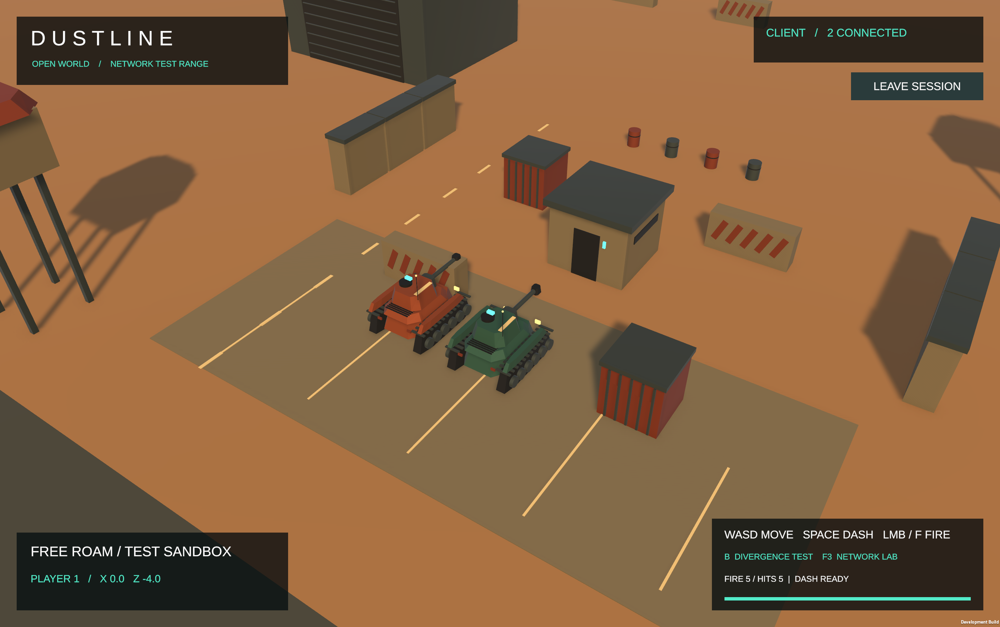

# DUSTLINE — сетевой танковый полигон

Unity-демонстрация многопользовательского движения, стрельбы и влияния задержки/потерь на сетевую игру. В этой ветке находится рабочая сцена с процедурными танками и песчаным полигоном.

## Скачать игру

Готовое приложение для macOS: [релиз DUSTLINE](https://github.com/teeeema/udp-csharp/releases/tag/dustline-20261024). Скачайте `Dustline-macOS.zip`, распакуйте и запустите `PR4PredictionDemo.app`.

## Запуск двух игроков

1. В первом экземпляре нажмите **START HOST / SOLO TEST**.
2. Откройте второй экземпляр приложения. На macOS: `open -n /полный/путь/PR4PredictionDemo.app`.
3. Во втором экземпляре укажите `127.0.0.1` и нажмите **JOIN**.
4. На экране появятся два танка и `2 CONNECTED`.

Для игры в локальной сети вместо `127.0.0.1` укажите адрес компьютера Host; используется UDP-порт 7777. Интернет-матчмейкинг и настройка NAT не реализованы. Автоматическая проверка выполнена на одном Mac в двух отдельных процессах.

## Управление

| Действие | Управление |
|---|---|
| Движение и направление корпуса | WASD |
| Выстрел вперёд по направлению корпуса | ЛКМ или F; можно удерживать |
| Рывок | Space |
| Намеренное расхождение для проверки серверной коррекции | B |
| Сетевая лаборатория | F3 |
| Процент логических потерь | Ползунок Packet loss в F3, 0–100% |

Смена потерь в окне Client влияет на его команды и обратные сообщения. Игрок Host работает непосредственно на сервере. Стрельба регистрирует попадания и отображает трассеры/вспышки; здоровье и разрушение не добавлены.

## Важные сетевые механики Unity

- Host/Client на Netcode for GameObjects и Unity Transport.
- Server authority: клиент отправляет ввод, сервер рассчитывает позиции, проверяет направление/перезарядку и столкновения.
- Client-side prediction: локальное движение без ожидания подтверждения сервера; переключение ON/OFF через F3.
- Server reconciliation: номера команд, подтверждения, очередь неподтверждённого ввода и повторное проигрывание.
- Удалённые игроки плавно следуют полученной серверной позиции; устаревшие обновления отбрасываются.
- Серверная стрельба: клиент отправляет номер запроса; сервер определяет направление, допустимость и ближайшее попадание, реплицирует счётчики и эффекты.
- Эмуляция задержки и детерминированных логических потерь: готовые профили 0 мс/0%, 100 мс/0%, 175 мс/5% и произвольный процент потерь.
- Диагностика ACK, ожидающих команд, ошибок корректировки и реакции на рывок.

Потери моделируются внутри приложения, до RPC; это не потеря всех UDP-пакетов соединения. Надёжные счётчики выстрелов/попаданий идут отдельно от фильтра эффектов. Производственная защита от читов, rollback, урон и lag compensation в объём демонстрации не входят.

## Открыть исходники в Unity

```bash
git clone --branch prac_4 https://github.com/teeeema/udp-csharp.git
```

Откройте `unity/PredictionDemo` в Unity **6000.3.8f1**. Дождитесь установки пакетов и откройте `Assets/Scenes/PredictionDemo.unity`. Для проверки нажмите Play. Меню `PR4 → Build macOS Demo` пересоздаёт рабочие процедурные ресурсы и собирает приложение в `Builds/PR4PredictionDemo.app`.

Пакеты: Netcode for GameObjects 2.13.3, Unity Transport 2.6.0, URP 17.3.0. Модели полигона и танков создаются собственным Editor builder. Шрифты и стандартные TMP-ресурсы содержат сопутствующие лицензии. Временные импортированные карты и сторонние пакеты танков в публикацию не включены.

## Проверки и материалы

- Unity EditMode: **8/8**, 0 failed.
- Реальный Unity Play Mode: стрельба, попадание, серверный cooldown; направление модели/трассера совпадает с корпусом после поворота на 90°.
- macOS build: `BUILD_OK`.
- Реальные Host + Client: 0%, 50%, 100% логических потерь; процессы завершились с кодом 0. При 100% сервер не принял ни одного выстрела соответствующего клиента.
- `.NET`: 78 тестов ПР1–ПР3 в предыдущем прогоне. Для этой публикации повторно не запускались.

[Управление, реализация и проверки стрельбы](docs/Shooting_and_Network_Lab.md) · [Поток prediction/reconciliation](docs/Prediction_Implementation.md) · [Матрица T1–T5](docs/Prediction_Test_Matrix.md) · [Логи и результаты](docs/test-results/shooting)

Сохранённые результаты T1–T5 относятся к более ранней проверке prediction. Текущие проверки стрельбы и потерь находятся в отдельном каталоге `shooting`; они не обозначают новый полный прогон T1–T5.



## Предыдущие практики: собственный UDP-протокол C#

Каталоги `src/`, `tests/` и `UdpGame.sln` содержат консольные клиент/сервер ПР1–ПР3: MOVEMENT, SHOOT, STATE_UPDATE, PING/PONG, ACK, ручную сериализацию, reliable SHOOT с повторными отправками, адаптивный RTO/Karn и серверную дедупликацию. Это отдельная реализация от Unity NGO.

```bash
dotnet test UdpGame.sln
```

[Спецификация протокола](docs/Protocol_Specification.md) · [Надёжная доставка](docs/Reliability_Protocol.md) · [Архитектура](docs/Architecture_Design.md)
