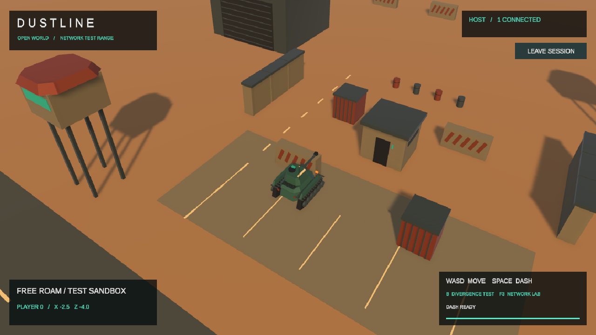
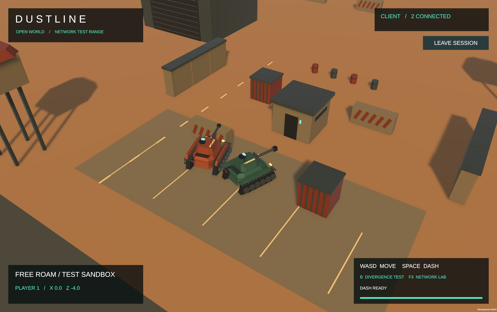

# Исходный DUSTLINE восстановлен — 23.10.2026

По скриншоту пользователя восстановлены процедурный танк с отдельными колёсами, башней и стволом, простой песчаный полигон, бункер, ангары, вышки, контейнеры, разметка парковки, прежняя камера и HUD.

Сцена: `unity/PredictionDemo/Assets/Scenes/PredictionDemo.unity`.
Сборка: `unity/PredictionDemo/Builds/PR4PredictionDemo.app`.

Сборщик `PredictionDemoBuilder.BuildDemoAssets()` снова сохраняет этот вид. Автоматическое применение MilitaryVisualUpgrade убрано, материалы сбрасываются к исходным одноцветным URP/Lit. При обычной пересборке Tiger и импортированное окружение больше не подставляются. TankForestRange и исходные ассеты оставлены в проекте как неактивные материалы предыдущей работы; сцена запуска и сборки — PredictionDemo.

Изменения увеличения карты и новой камеры из отменённой задачи не начинались. Код runtime, сети, HUD, управления, предсказания, столкновений и тестов не изменён: 40/40 C# файлов совпадают с резервной точкой. Восстановлена сцена, визуальная часть общего prefab и её материалы; сборщик изменён только для сохранения исходного оформления.

Резервная точка перед восстановлением: commit `3e4258d2beb33a07b2b2c499c22f26ab817dc14b`. Рабочая ветка: `codex/restore-original-dustline-20261023`.

Фактически выполнено:

- Unity EditMode: 8/8, 0 failed — [результат](test-results/dustline-restored/unity-tests.json).
- Editor Play Mode: локальный Host, появление исходного танка, обновление счётчика кадров и визуальная сверка Game View со скриншотом пользователя.
- Консоль Editor после Play Mode: 0 ошибок — [консоль](test-results/dustline-restored/console.json).
- Native macOS BuildPipeline: Build Finished, Result: Success — [результат](test-results/dustline-restored/build.json).
- Два экземпляра пересобранного приложения: Host + Client, второй авторитетный танк создан сервером; кадр клиента визуально проверен — `CLIENT / 2 CONNECTED`, оба исходных танка — [результат](test-results/dustline-restored/multiplayer.json).
- Сохранность 40 файлов runtime/тестов — [проверка](test-results/dustline-restored/preservation.json).

Новый полный прогон .NET и матрица T1–T5 не выполнялись: их исходники не менялись. Текущая задача — восстановление прежнего вида.

