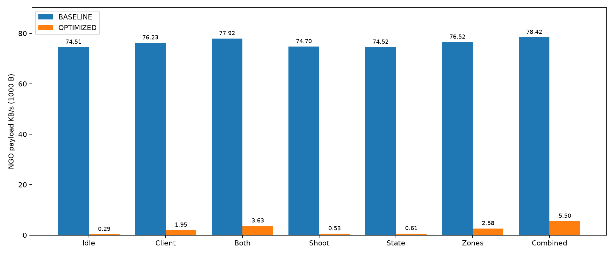

# OPTIMIZED после исправлений — 06.11.2026

Unity 6000.6.7f1, NGO 2.13.3, Transport 6.6.0, URP 17.6.0; macOS Apple Silicon. Два отдельных процесса одной development-сборки, Host + один Client, 50 серверных props, profile 0. Сессия каждого режима — 120 с после старта сетевой роли. BASELINE и OPTIMIZED запускались последовательно; во время замеров другие сетевые диагностики не выполнялись. Сценарии задаются одинаковыми временными интервалами и кнопками. Реальное число выстрелов может немного отличаться из-за кадровой дискретизации и серверного cooldown. Измеряется NGO payload, KB=1000 байт, а не UDP wire-трафик; UTP ACK/повторы/UDP-IP заголовки исключены.

Окна по общим часам NGO ServerTime: покой 8–18 с; Client 21–31; оба 33–43; стрельба 45–55; состояния 57–67; зоны 69–95; комбинация 101–115. Начальная синхронизация исключена. Средняя скорость = разность накопленных байтов / фактическая длительность окна / 1000. Скрипт отклоняет окно, если не видит двух игроков. Счётчики опубликованы в [traffic-counters.csv](data/traffic-counters.csv), полный агрегат — [traffic-summary.json](data/traffic-summary.json). CSV — документальная выгрузка исходных SAMPLE-строк без позиций игроков и диагностических подробностей. Поля: mode, role, t (NGO ServerTime, секунды), props (локальное число props), players, tx/rx (накопленные NGO payload-байты). Все семь окон и оба направления сверены с исходными .state, без изменения точности. Начальная синхронизация исключена. Целевые частоты props — 30/5/2 Hz; фактические ограничены Update/FPS.

| Сценарий | BASELINE TX Host KB/s | OPTIMIZED TX Host KB/s | Снижение |
|---|---:|---:|---:|
| Неподвижные игроки | 74.506 | 0.294 | 99.605% |
| Движение Client | 76.235 | 1.955 | 97.436% |
| Движение обоих | 77.923 | 3.631 | 95.340% |
| Стрельба | 74.703 | 0.532 | 99.287% |
| Изменение мишени | 74.524 | 0.607 | 99.186% |
| Между зонами | 76.516 | 2.578 | 96.631% |
| Движение и стрельба обоих | 78.423 | 5.501 | 92.985% |

Reduction = (Baseline - Optimized) / Baseline × 100%. Проценты вычислены из неокруглённых счётчиков, ориентир методички не использовался для подбора параметров. Для комбинированной нагрузки снижение 92.985%; для покоя 99.605%.

Две функциональные техники: (1) distance relevance — NetworkHide/Show отдельно для каждого клиента, радиус 38 м, проверка раз в 0,2 с; (2) scheduler — 5 Hz для мишеней, 2 Hz для индикаторов, отсутствие periodic snapshots статичных props. «Сон» является частью scheduler, а не третьей независимой движковой системой. Квантование до 0,1 м — порог изменений, float32 wire-размер Vector3 не сокращён. Dirty tracking NGO не считается новой оптимизацией. Игроки и критичные RPC не отсекаются по дистанции.

Большое снижение связано с избыточной базовой рассылкой и количеством нерелевантных/статичных объектов. Для активной игры выигрыш меньше, чем для покоя. Нельзя выдавать эти проценты за универсальную производительность NGO. Отдельная абляция и NGO-native baseline не выполнены. Начальный spawn ещё идёт всем наблюдателям до первого cull, поэтому стартовый пик не устранён полностью. Неизменность игрового runtime DLL между измерением и финальной пересборкой диагностического модуля: **True**; локальная сверка SHA-256 дала совпадение. Исходники и DLL в эту публикацию не включены.

Дополнительно проверены реальный пеший выход/возврат и актуальное состояние после возвращения, два удалённых клиента, повторные сессии и UTP simulation 100 ms/0%, 175 ms/5%. Полный UDP-захват остаётся BLOCKED из-за прав macOS BPF; права не менялись. Одного парного сценарного прогона недостаточно для статистической оценки всех сетей/карт. График сравнения приведён ниже.

[Обзор ПР №5](README.md) · [BASELINE](Replication_Baseline.md) · [Оптимизации](Replication_Optimization.md) · [Проверки](Testing_Report.md) · [Исправления](Defect_Fix_Report.md) · [Unity-адаптация](Unity_Adaptation.md)
