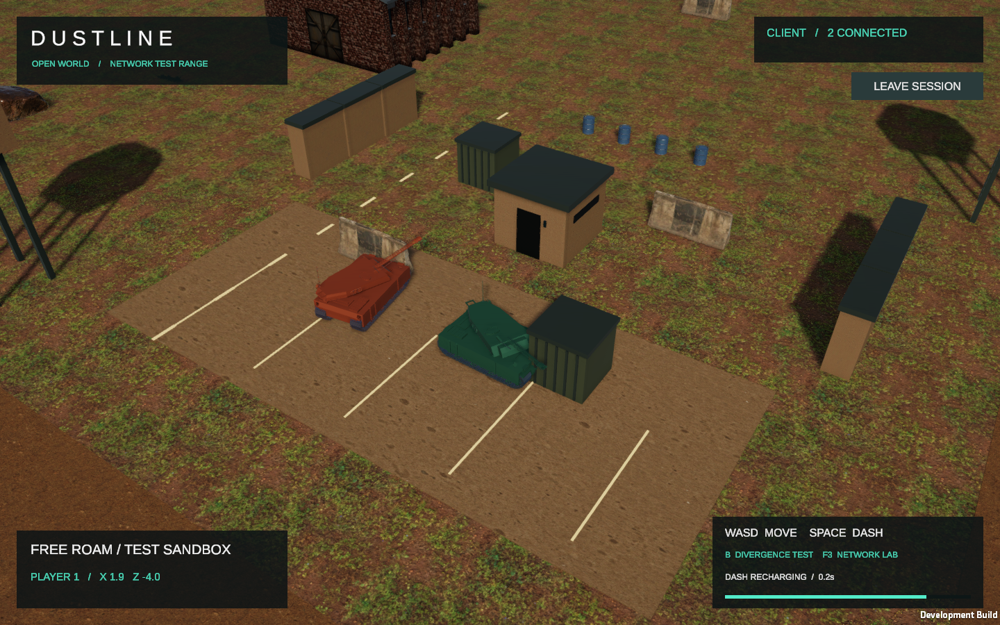
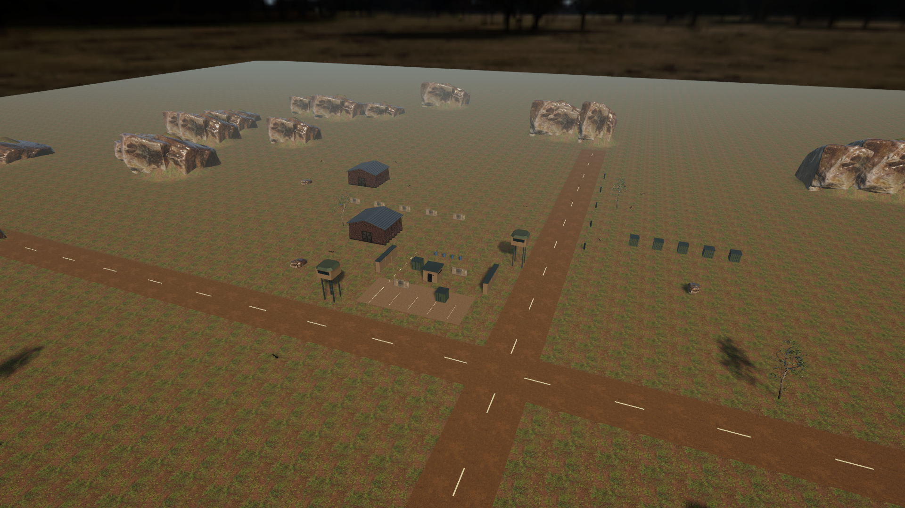

# Визуальная переработка полигона с сохранением практик

Дата: 22 октября 2026 года. Unity 6000.3.8f1, прежний Universal Render Pipeline 17.3.0.

## Учебное назначение сохранено

- **ПР1:** собственные консольные UDP-клиент/сервер, MOVEMENT, SHOOT, STATE_UPDATE и ручная сериализация.
- **ПР2:** PING/PONG, RTT/SRTT, джиттер, потери, эмулятор и сохранённые измерения.
- **ПР3:** ACK, requiresAck, ReliableChannel, adaptive RTO, Karn, ограниченные повторы, failed и серверная дедупликация.
- **Unity / ПР4:** прежние вводы и RPC, client-side prediction, server reconciliation, replay, server-authoritative движение, обычный dash и намеренное расхождение B.

Unity остаётся отдельным стендом на Netcode for GameObjects. Он не объявляется визуальным клиентом собственного UDP-протокола. Мир остаётся открытым тестовым полигоном, без заданий, заезда или таймера прохождения.

## Установленные готовые модели

Все модели действительно скачаны, преобразованы в FBX, импортированы и использованы в prefab или сцене. Процедурный танк заменён готовой моделью Abrams.

| Ассет | Автор | Исходник / лицензия | Треугольников в подготовленной модели |
|---|---|---|---:|
| Abrams tank | Sketlux, на основе танка Freeciv автора yd | [OpenGameArt](https://opengameart.org/content/abrams-tank), CC0 | 37 340 |
| Warehouse building, low poly | 32kda; исходная текстура включает CC0-материалы Screaming Brain Studios | [OpenGameArt](https://opengameart.org/content/warehouse-building-low-poly), CC0 | 344 |
| Concrete Road Barrier | Amal Kumar | [Poly Haven](https://polyhaven.com/a/concrete_road_barrier), CC0 | 12 000 |
| Rock 07 | Jenelle van Heerden | [Poly Haven](https://polyhaven.com/a/rock_07), CC0 | 6 000 |
| Grass Bermuda 01 | Rico Cilliers | [Poly Haven](https://polyhaven.com/a/grass_bermuda_01), CC0 | 941 |
| Wild Rooibos Bush | James Ray Cock / Jenelle van Heerden | [Poly Haven](https://polyhaven.com/a/wild_rooibos_bush), CC0 | 6 000 |
| Barrel 03 | Serhii Khromov | [Poly Haven](https://polyhaven.com/a/barrel_03), CC0 | 1 473 |
| Tree Small 02 | Rico Cilliers | [Poly Haven](https://polyhaven.com/a/tree_small_02), CC0 | 50 000 |

Дополнительно импортированы поверхности [Brown Mud Leaves 01](https://polyhaven.com/a/brown_mud_leaves_01), [Concrete Floor](https://polyhaven.com/a/concrete_floor), [Gravelly Sand](https://polyhaven.com/a/gravelly_sand) и небо [Dry Field](https://polyhaven.com/a/dry_field). Лицензия ресурсов Poly Haven — [CC0](https://polyhaven.com/license); условия CC0 — [Creative Commons](https://creativecommons.org/publicdomain/zero/1.0/).

Исходные страницы лицензий, API-метаданные загрузок и SHA-256 исходных архивов сохранены в `Assets/ThirdParty/MilitaryRange/Licenses/`. Скачанные файлы Poly Haven проверены по MD5 из API. Платные ассеты не использованы. Исходные модели обрабатывались Blender с отключённым выполнением встроенных скриптов.

У исходного Abrams цветовые материалы, а не фототекстурированный PBR-комплект. Они переведены в URP Lit. Окружение использует реальные diffuse/normal/ORM-текстуры. Не заявляется наличие отсутствующих заводских PBR-текстур или анимационного рига танка.

## Что изменилось визуально

- Дочерний `Visual` существующего `PredictedPlayer.prefab` содержит импортированный Abrams; функциональные компоненты корня сохранены.
- Сохранена прежняя ширина шасси и привязка модели к фиксированной высоте сетевого root. Разный цвет локальной и удалённой машины продолжает назначаться прежним кодом.
- Готовые склад, бетонные заграждения, бочки и камни заменяют соответствующие видимые примитивы. Их прежние физические объекты не удаляются.
- Добавлены Terrain 500 × 500 м, текстурированный грунт, грунтовые тестовые дороги, трава, кусты и деревья.
- Центральные площадки, длинные дороги и существующий маршрут проверки свободного выезда оставлены открытыми.
- Настроены HDRI-небо, мягкие направленные тени, ambient lighting, reflection probe, HDR, MSAA 4×, FXAA, ACES, умеренная коррекция цвета и bloom.
- ORM преобразован в расположение каналов Unity: metallic, occlusion и smoothness; normal-текстуры импортируются как Normal Map.

### Как сохранён рельеф без изменения движения

Движение лабораторного проекта рассчитано на фиксированный Y=1. Его не меняли на движение по поверхности Terrain. Поэтому тестовые проезды остаются плоскими. Высотный рельеф находится внутри прежних заблокированных областей скал; исходные коллайдеры сохранены, новый TerrainCollider удалён. Декоративная растительность и отдельные новые камни не имеют коллайдеров; физически блокирующие скалы используют исходные коллайдеры.

Это осознанное ограничение ради сохранения физики практики. Движение танка вверх и вниз по холмам не добавлено.

## Производительность

- Текстуры подготовлены в 1K с mipmaps и импортной компрессией Unity.
- Исходное дерево примерно с 2.06 млн полигонов упрощено до 50 тыс. треугольников; другие тяжёлые модели также ограничены бюджетом.
- Модели объединены при подготовке, материалы используют instancing, декоративные объекты имеют отсечение по экранному размеру через LODGroup. Это один видимый уровень с отсечением, а не набор нескольких геометрических LOD.
- Размер подготовленного набора и фактические замеры фиксируются в результатах проверки. Короткие локальные измерения Editor не считаются испытанием VR-производительности или гарантией FPS на другом устройстве.

## Сохранение структуры и поведения

[Хеши до изменений](test-results/visual-upgrade/behavior-baseline-sha256.json) охватывают 52 файла: консольные исходники/проекты, Unity runtime-скрипты и тесты. [Итог сверки](test-results/visual-upgrade/behavior-integrity.json) показывает отсутствие изменений этих файлов.

[Сравнение коллайдеров](test-results/visual-upgrade/collider-invariants.json) проверяет тип, enabled, isTrigger, мировые position/rotation/scale и параметры формы: все 52 исходных коллайдера совпадают.

[Корневые компоненты prefab](test-results/visual-upgrade/root-components-unchanged.json): сохранены NetworkObject, PredictedPlayer и TankPresentation, их настройки, file ID и GUID исходного prefab. Служебный GlobalObjectIdHash автоматически пересчитывается NGO OnValidate при редактировании/import prefab; это явно исключено из побайтового сравнения сериализованных настроек.

Методичка сдачи остаётся применимой: фрагменты сетевой логики не переписаны. Описание прежней процедурной модели следует читать с учётом этого отчёта.

## Изменённые файлы и воспроизведение

| Путь относительно Unity-проекта | Изменение |
|---|---|
| `Assets/Editor/ProjectBootstrap/PredictionDemoBuilder.cs` | После прежней сборки функциональной сцены вызывает визуальный слой |
| `Assets/Editor/ProjectBootstrap/MilitaryVisualUpgrade.cs` | Импортные материалы/prefab, замена визуальных дочерних объектов, Terrain, декор и освещение |
| `Assets/ThirdParty/MilitaryRange/` | FBX, текстуры, материалы, prepared prefab, TerrainData, профиль post-processing, лицензии |
| `Assets/Prefabs/PredictedPlayer.prefab` | Новая визуальная модель при прежнем функциональном корне |
| `Assets/Scenes/PredictionDemo.unity` | Обновлённое окружение и настройки отображения |
| `Assets/Materials/` | Визуальное согласование бетона, окрашенного металла и стекла |
| `Assets/Settings/` / активный URP Asset | HDR, MSAA и дальность теней |

Подготовка геометрии описана в `scripts/convert_visual_assets.py` в корне репозитория. Исходные загрузки для повторной конвертации staging-скрипт ожидает в `tmp/visual-assets`.

Меню **PR4 → Build Demo Assets** пересоздаёт функциональную сцену и применяет импортированные визуальные ассеты. **PR4 → Build macOS Demo** также собирает приложение. Изменение только визуального дочернего объекта вручную не требует переписывать сетевые компоненты.

## Результаты проверок

Фактические исходные и итоговые результаты сохранены в `docs/test-results/visual-upgrade/`. [Сводка проверок](test-results/visual-upgrade/verification-summary.json).

| Проверка | Фактический результат |
|---|---|
| .NET до / после | 78/78 в обоих прогонах |
| Unity EditMode до / после | 8/8 в обоих прогонах; ни один тест не отключён |
| Защищённые файлы поведения | 52/52 совпадают по SHA-256 |
| Коллайдеры | Все 52 совпадают по форме, положению и настройкам |
| Сборка macOS | Успешна; результат `visual upgrade build complete` |
| Host + Client | Создан удалённый игрок; оба экземпляра показывают новые танки |
| Обычный dash | Штатная CLI-автоматизация: локальная реакция 0.0 мс по лабораторному таймеру, сервер ACCEPT |
| Prediction OFF | Управление через очередь Input System в Editor: реакция dash 239.2 мс при задержке 100 мс в каждом логическом направлении |
| Намеренное расхождение | B через очередь Input System на свободной дороге: коррекция 3.08 м |
| Неверный повторный dash | Отдельный owned-RPC negative probe: первый запрос ACCEPT, второй `REJECT validation=rejected:cooldown` |
| 175 мс / 5% | 43 наблюдённых DROP-события по двум направлениям; сервер принял два законных dash после ожидания cooldown |
| Runtime-исключения | В сохранённых runtime-логах проверок не обнаружены |
| Визуальная проверка | Просмотрены реальные снимки host/client и обзор сцены |

Сетевые сценарии проверялись разными способами, указанными в таблице. При первой подаче коротких клавиш в Editor часть фронтов нажатия не попала в FixedUpdate; такое поле результата не засчитано как PASS. Обычный dash подтверждён отдельной штатной CLI-проверкой, cooldown — отдельным негативным сетевым запросом. Это не полный новый прогон матрицы T1–T5 и не исчерпывающая проверка всех физических нажатий клавиатуры.

Короткий замер в Editor на Apple M4 после прогонов: `smoothDeltaTime≈3.26 мс`, 1796×789, около 1.17 млн отображённых треугольников с учётом проходов и 741 batches. До изменения сохранён отдельный отсчёт ≈2.70 мс; условия нагрузки и набор видимых объектов различаются, поэтому эти числа не выдаются за строгий сравнительный benchmark. [До](test-results/visual-upgrade/performance-before.json), [после](test-results/visual-upgrade/performance-after.json).

### Вид в приложении

### Обзор окружения

Камера временно отодвинута только для этого снимка; её штатное слежение в проекте не менялось.

[Исходный вид до переработки](media/visual-upgrade/before.png).

## Ограничения

- Сцена остаётся учебным стендом, а не готовой боевой игрой: стрельба снарядами и новые игровые механики не добавлялись.
- Исходный Abrams не имеет готового рига гусениц/башни; новая анимация башни и гусениц не добавлена. Сетевое движение и визуальный разворот сохранены.
- Отдельные существующие простые сооружения сохранены и получили новые материалы; не каждый объект локации заменён отдельной скачанной моделью.
- Полная матрица сетевых условий и производительность на реальной внешней сети требуют отдельных испытаний. Локальный тест не доказывает поведение в Интернете.
- Статус issues/PR/ревью для сдачи ПР3 этим визуальным изменением не подтверждается.
