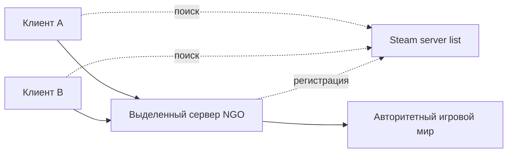
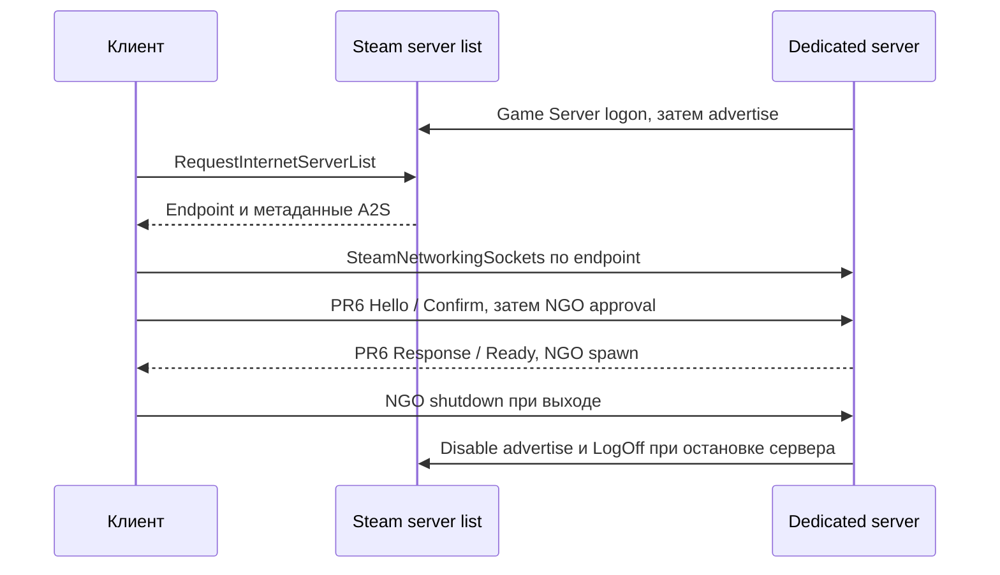
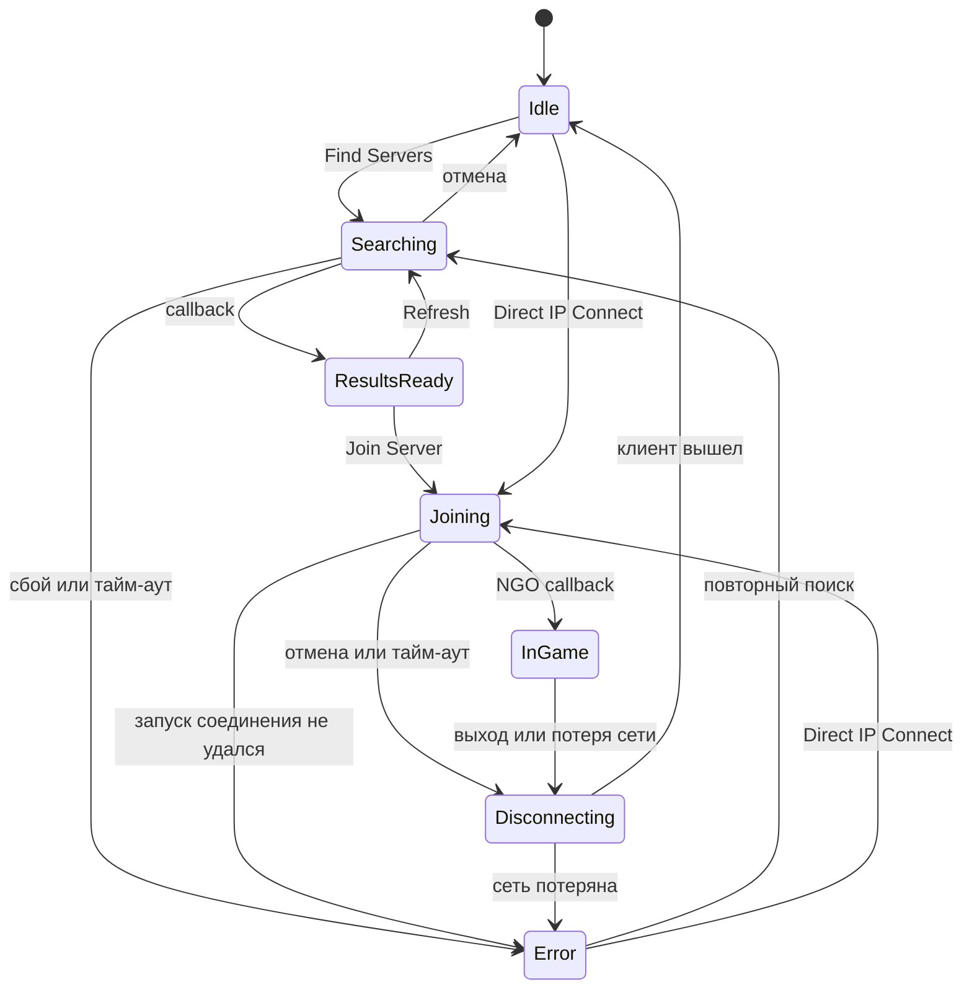

# Архитектура DUSTLINE ПР7

Клиент и выделенный сервер загружают `PredictionDemo` (Copper Basin в этой рабочей копии). Dedicated Server Subtarget определяет `UNITY_SERVER`. Bootstrap вызывает `NetworkManager.StartServer()` при загрузке сцены. Сервер подключает только удалённых клиентов и выделяет им игровые слоты. В Steam-профиле NGO Connection Approval проверяет лимит мест и совместимость сборки. В IP-профиле bootstrap проверяет слоты при подключении и сохраняет исходный формат запросов NGO. Здоровье игрока, предсказание ввода, результаты стрельбы и репликация остаются в существующих компонентах игры.

Один сервис на клиенте управляет Direct IP, поиском Steam и статусом NGO. UI передаёт команды сервису. Dedicated server публикует сессию после запуска слушателя и подтверждения входа в Steam backend. Связь фактически установлена после callback NGO о подключении локального клиента.

| | IP | Steam |
|---|---|---|
| Обнаружение | Ввод IPv4 или DNS и порта | Internet-list Steam Game Server |
| Носитель | UDP Socket | Steam Networking Sockets direct-IP |
| Игровой транспорт | NGO / UTP поверх защищённых датаграмм ПР6 | NGO / UTP поверх тех же защищённых датаграмм |
| Порты | Игровой UDP 7777 | Игровой UDP 7777 и query UDP 27015 |
| Совместимость | Существующий защищённый профиль ПР6 | Клиент и сервер PR7 с разрешённым App ID и совпадающим BUILD_ID |

UTP формирует игровые датаграммы и надёжные последовательности. ПР6 шифрует датаграммы перед передачей в выбранный носитель. В Steam-профиле используется ненадёжная отправка без ожидания на уровне Steam, надёжность и фрагментация остаются обязанностью UTP. Активная аутентификация исходного X25519 handshake ПР6 по-прежнему отсутствует. Для маршрута см. [STEAM_INTEGRATION.md](STEAM_INTEGRATION.md).

Клиент передаёт ввод и последовательность команд движения. `PredictedPlayer` проверяет владельца, порядок и бюджет команд, затем симулирует перемещение на сервере. `TankWeapon` проверяет последовательность, допустимость направления и интервал между выстрелами. Попадание, урон, здоровье и авторитетные координаты определяются на сервере. Подключение через Steam использует эти же игровые проверки.
