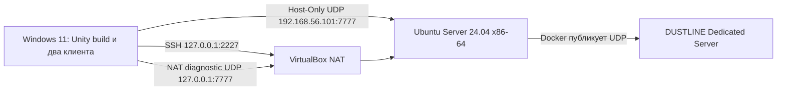

# Настройка Ubuntu Server в VirtualBox



## Гостевая система

1. Скачайте `ubuntu-24.04.5-live-server-amd64.iso` и `SHA256SUMS` у Canonical. Сверьте `Get-FileHash -Algorithm SHA256` с записью выбранного ISO. [Релизы Ubuntu 24.04](https://releases.ubuntu.com/24.04/)
2. Создайте VM `UnityDedicatedServer-PR7`, 2 vCPU, 4096 МБ ОЗУ, динамический диск 20480 MiB. Выберите NAT, Ubuntu 64-bit и установку OpenSSH Server. Windows 11 и Ubuntu 24.04 перечислены в руководстве VirtualBox. [Документация Oracle](https://docs.oracle.com/en/virtualization/virtualbox/7.2/user/installation.html)
3. Для локального прогона задайте маршруты `127.0.0.1:2227/tcp → guest:22/tcp` и `127.0.0.1:7777/udp → guest:7777/udp` в настройках NAT VirtualBox. Добавьте свой открытый SSH-ключ гостевому пользователю. Первое подтверждение отпечатка сверяйте с `ssh-keygen -lf /etc/ssh/ssh_host_ed25519_key.pub` в консоли VM.
4. При использовании образа Canonical для облачных VM к диску подключается NoCloud seed с собственным открытым SSH-ключом. Импортируйте проверенный VMDK как VirtualBox VDI, задайте 20 GiB и расширьте корневой раздел при первом запуске через cloud-init. [Ubuntu Noble cloud images](https://cloud-images.ubuntu.com/noble/current/) · [NoCloud](https://docs.cloud-init.io/en/latest/reference/datasources/nocloud.html)

В лаборатории первый NIC остаётся NAT. Для локального игрового пути добавлен второй NIC **Host-Only**. IP адаптера Windows — `192.168.56.1/24`, статический IP гостя на `enp0s8` — `192.168.56.101/24`, шлюз на втором NIC отсутствует. Причина — при loopback-пробросе Ubuntu видела запросы к контейнеру и выходящие ответы, при этом клиенты Windows не завершали PR6 handshake. SSH выполняется через исходный NAT loopback. [Сетевые режимы VirtualBox](https://docs.oracle.com/en/virtualization/virtualbox/7.2/user/networkingdetails.html)

На этом Windows-хосте VirtualBox использовал Hyper-V/NEM. После добавления второго NIC Ubuntu задерживалась в initramfs на загрузке драйверов. Повторный запуск с профилем паравиртуализации **None** успешен. В госте подтверждены два доступных CPU. Настройка относится к этой VM. [Параметры VBoxManage](https://docs.oracle.com/en/virtualization/virtualbox/7.2/user/vboxmanage.html)

## Docker Engine

В Ubuntu используйте официальный APT-репозиторий Docker. Выполните из локального SSH-сеанса пользователя, который администрирует только эту VM.

```sh
sudo apt-get update
sudo apt-get install -y ca-certificates curl
sudo install -m 0755 -d /etc/apt/keyrings
sudo curl -fsSL https://download.docker.com/linux/ubuntu/gpg -o /etc/apt/keyrings/docker.asc
sudo chmod a+r /etc/apt/keyrings/docker.asc
sudo tee /etc/apt/sources.list.d/docker.sources >/dev/null <<'EOF'
Types: deb
URIs: https://download.docker.com/linux/ubuntu
Suites: noble
Components: stable
Architectures: amd64
Signed-By: /etc/apt/keyrings/docker.asc
EOF
sudo apt-get update
sudo apt-get install -y docker-ce docker-ce-cli containerd.io docker-buildx-plugin docker-compose-plugin
sudo docker version
sudo docker compose version
sudo docker run --rm hello-world
df -h /
```

Те же шаги выполняет `sudo sh scripts/provision-docker.sh` после копирования файла в VM. Группа `docker` предоставляет эквивалент полномочий root. Для лабораторного запуска можно пользоваться `sudo` через SSH. Параметр скрипта деплоя `-Sudo` открывает терминал для штатного запроса пароля гостевой системы. [Установка Docker Engine для Ubuntu](https://docs.docker.com/engine/install/ubuntu/)
