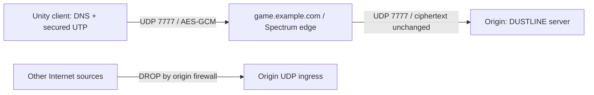

# Cloudflare Spectrum — ПР №6

**Статус — ожидает инфраструктуру.** 21.11.2026 список доменов в открытом аккаунте Cloudflare пуст. Для развёртывания нужны активная зона с доступом к Spectrum UDP и игровой сервер с публичным адресом и доступом к его firewall. Приложение Spectrum, DNS, правила firewall, тест через Cloudflare и скриншоты настроек остаются открытыми.

## Условия и архитектура

Для произвольного игрового UDP требуется платное дополнение Spectrum UDP на уровне Enterprise. Доступ к Spectrum Enterprise предоставляется отдельно от тарифа зоны Enterprise. Перед настройкой проверьте доступ к Spectrum UDP для нужной зоны, адрес и ОС origin и сохраните способ административного доступа к серверу. [Поддержка протоколов по тарифам Cloudflare](https://developers.cloudflare.com/spectrum/protocols-per-plan/)

Реальный игровой порт проекта — **7777** (9000 — только порт учебного примера). Можно согласовать edge 9000 → origin 7777, тогда клиенту передавать `--pr4-port 9000`. Для доказательств локального relay используются 7906 → 7907. Ключи согласуются между Unity-клиентом и origin, Spectrum их не получает.

## Настройка после явного разрешения

1. Проверить активный Enterprise plan, Spectrum UDP entitlement, требуемые квоты и доступ к Networking → Spectrum. Получить согласованные `ZONE_ID`, `game.example.com`, origin IPv4/IPv6 и порт. Секреты держать вне Git и скриншотов.
2. Проверить origin на выделенном UDP 7777, запуск и логи безопасного handshake. Согласовать публичный адрес; не публиковать его в общедоступной документации. При известном историческом IP рассмотреть согласованную смену origin адреса.
3. По [Get started](https://developers.cloudflare.com/spectrum/get-started/) создать Application: UDP, edge 7777, domain `game.example.com`, origin IP:7777. Убедиться, что тип именно `udp/7777`, а не TCP/HTTP. Записать Application ID и фактические поля настроек.
4. Настроить DNS, созданный для Spectrum application. Проверить резолвинг на edge, не на origin. Не создавать публичный DNS-only alias, раскрывающий origin. Убедиться, что обычный orange-cloud DNS не выдан за настройку Spectrum.
5. Выставить **Proxy Protocol off** для текущей реализации. Она ожидает `DSL6` в начале UDP и не разбирает SPP/PROXY v2. UDP проксирование меняет видимый IP/port: сервер идентифицирует игрока по сохранённому endpoint прокси и криптосессии, NGO выдаёт независимые ClientId. Реальный IP клиента в текущем приложении **не доступен**. При необходимости отдельно реализовать SPP, проверять заголовок только от доверенных proxy ingress и добавлять симметричный заголовок ответов. Формат и различия SPP/PROXY v2: [Enable Proxy protocol](https://developers.cloudflare.com/spectrum/how-to/enable-proxy-protocol/).
6. Подготовить и показать администратору правила firewall **до применения**: разрешить входящий UDP 7777 от актуальных Cloudflare source ranges; запретить остальные источники на этот порт; оставить согласованный административный доступ; не открывать другие UDP-порты и IPv6 обход. Правила должны разрешать ответы и established egress согласно ОС. Политику по умолчанию целиком не менять без отдельного плана.
7. Проверить получаемый сервером IP/port легитимного подключения и сверить с диапазонами. Без SPP per-IP handshake limiter видит общий proxy IP: лимит 2/s burst 4 может ограничить совместный login многих игроков. Для production нужен согласованный gateway/validated SPP и настройка лимитов; не доверять IP из произвольного пользовательского payload.
8. Сохранить скриншоты Application, DNS, доступных DDoS параметров, обезличенные firewall counters, DNS query, успешные журналы клиента/origin. В этой работе таких скриншотов нет.

## Диапазоны и firewall

[Официальная рекомендация Spectrum](https://developers.cloudflare.com/spectrum/about/ddos-for-spectrum/) — закрывать origin от источников вне Cloudflare ranges. Источник актуальных диапазонов: [IPv4](https://www.cloudflare.com/ips-v4/), [IPv6](https://www.cloudflare.com/ips-v6/), [описание](https://www.cloudflare.com/ips/). Перед применением повторно загрузить, проверить и атомарно заменить разрешённые наборы; не оставлять навечно снимок списка.

Снимок IPv4 от 17.11.2026: `173.245.48.0/20`, `103.21.244.0/22`, `103.22.200.0/22`, `103.31.4.0/22`, `141.101.64.0/18`, `108.162.192.0/18`, `190.93.240.0/20`, `188.114.96.0/20`, `197.234.240.0/22`, `198.41.128.0/17`, `162.158.0.0/15`, `104.16.0.0/13`, `104.24.0.0/14`, `172.64.0.0/13`, `131.0.72.0/22`.

IPv6: `2400:cb00::/32`, `2606:4700::/32`, `2803:f800::/32`, `2405:b500::/32`, `2405:8100::/32`, `2a06:98c0::/29`, `2c0f:f248::/32`. Это общие официальные origin source ranges; для специальной схемы Enterprise/BYOIP согласовать применимость с account team и подтвердить реальным ingress. Простое разрешение общего Cloudflare диапазона не аутентифицирует конкретного пользователя или вашу application.

Правила здесь — план, **не выполненные shell-команды**. У ОС origin пока нет подтверждения, поэтому готовый `iptables/pf/nft` ruleset не применялся. Основной риск — известный origin IP позволяет обойти edge, если firewall этого не запрещает. Само шифрование не предотвращает насыщение канала origin.

## DDoS и ограничения

Spectrum предоставляет [L3/L4 DDoS protection](https://developers.cloudflare.com/spectrum/about/ddos-for-spectrum/); Network-layer DDoS Attack Protection managed ruleset включён по умолчанию согласно документации. В кабинете проверить фактическое состояние, доступные sensitivity/action overrides, Network Analytics → DDoS managed rules → mitigation reasons. Их наличие и изменение здесь **NOT_VERIFIED**, не все параметры доступны на каждом контракте. HTTP WAF/L7 managed rules не расшифровывают и не анализируют игровой AES payload.

По [Limitations](https://developers.cloudflare.com/spectrum/reference/limitations/) UDP IP fragments отбрасываются; custom rules не работают для Spectrum, использовать поддерживаемые IP Access rules и доступные настройки application. Текущий transport ограничивает внешнюю UDP payload 1200 B (включая 48 B обёртки), оригинальная фрагментация UTP выполняется до шифрования. Размер с IPv6/UDP — 1248 B, но путь с дополнительным encapsulation и WAN всё равно требует теста MTU. Максимум не подтверждён через Spectrum.

## План приёмки

| Проверка после настройки | Ожидаемое доказательство | Сейчас |
|---|---|---|
| DNS game.example.com | edge IP в `dig`, origin не раскрывается | BLOCKED_EXTERNAL |
| Успешный клиент через edge | HANDSHAKE_OK с обеих сторон, движение и выстрелы | BLOCKED_EXTERNAL |
| Два независимых удалённых клиента | разные NGO ClientId, корректная репликация | BLOCKED_EXTERNAL |
| Источник на origin | IP/port принадлежит доверенному proxy ingress | BLOCKED_EXTERNAL |
| Прямое подключение к origin | согласованный одиночный тест не проходит, firewall counter растёт | BLOCKED_EXTERNAL |
| Нет IPv6/альтернативного порта обхода | согласованный перечень правил/прослушиваемых портов | BLOCKED_EXTERNAL |
| DDoS Protection | реальные dashboard screenshots и Analytics | BLOCKED_EXTERNAL |
| MTU/reconnect/reliable SHOOT | реальные клиентские логи при потерях, без IP fragmentation | BLOCKED_EXTERNAL |

Тест обхода выполнять только с разрешённых собственных адресов, без нагрузочной атаки. Не генерировать Internet DDoS для учебного доказательства. Для полного соответствия нужны реальные доступы, отдельное разрешение инфраструктурных действий, результаты таблицы и независимое ревью.
